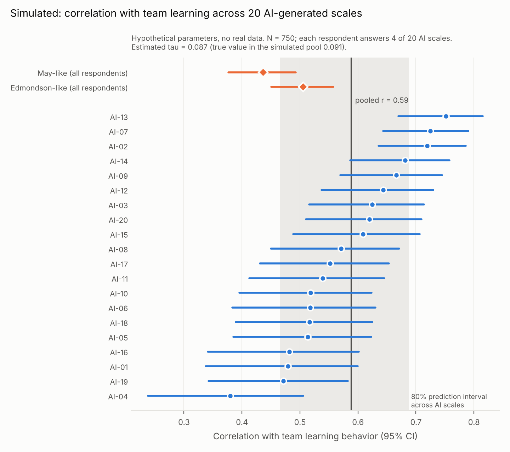

# Simulation and Power Analysis

All results on this page come from simulated responses with hypothetical parameters. No participant data were collected, and no properties of the actual AI-generated scales were estimated. The simulation tests whether the analysis recovers measure-dependent variation and how many respondents the design requires.

## What the design estimates

Each respondent answers the established psychological safety scales (Edmondson-like and May-like forms), Edmondson's team learning behavior scale, and *m* AI-generated scales drawn at random from a pool of *K*. For each AI scale we compute its correlation with team learning. A random-effects model (REML on Fisher *z*) then estimates:

- **tau**: the standard deviation of the true correlation across AI-generated measures of the same construct. This is the quantity for RQ1, and it separates measure-dependent variation from sampling error.
- **the overlap slope**: a meta-regression of each scale's correlation on a text-derived index of how much its wording overlaps with the team learning items (RQ2).
- **the placement of the established scales** within the AI distribution.

The tau interval uses the Q-profile method (Viechtbauer, 2007). The interval for the pooled correlation uses a respondent-level bootstrap. The overlap slope uses a Knapp–Hartung test.

## How the AI scales vary in the simulation

Each item has a fixed reliability (communality). An item's content can partly describe learning behavior (for example, speaking up or asking questions). That shifts what the item measures without changing its reliability, so a scale can look fine psychometrically while its meaning moves toward the outcome. Scales also differ in their average loading. Four pools of 400 scales set how much the scales differ:

| Pool | Share of items with learning content | True tau (r) | Mean r with learning | Range across pool |
|---|---|---:|---:|---|
| none | 0 | .001 | .46 | .46 to .47 |
| low | about 10% | .023 | .48 | .42 to .56 |
| medium | about 20% | .051 | .51 | .41 to .68 |
| high | about 40% | .091 | .57 | .37 to .77 |

The latent correlation between safety and learning (.56) was set so that the Edmondson-like scale correlates about .49 with the learning composite, close to the mean observed individual-level correlation of .48 in Frazier et al. (2017, Table 1).

## Benchmark from the literature

Frazier et al. (2017, Table 1) report, for psychological safety with learning behavior at the individual level, *k* = 15 correlations, *N* = 4,648, mean observed *r* = .48, and 7.21% of the variance in observed correlations accounted for by sampling error (the table note's definition of %-Acc). They do not report SD-rho or a credibility interval. Applying the Hunter–Schmidt sampling-error variance at the average study size (about 310) gives a residual SD of about **.16** in observed correlations once sampling error is removed. The reconstruction is approximate because it uses the average study size. The residual also still contains differences in reliability across studies, which is equally true of tau in our design, so the two are on the same footing. A measure-dependent tau of .05 corresponds to about 10% of that between-study variance; a tau of .09 corresponds to about a third.

## Monte Carlo results (400 replications per cell)

Rejection rates at alpha = .05. "Heterogeneity test" is the Q test that tau = 0.

| Pool | N | K | m | Respondents per scale | Mean tau estimate | Heterogeneity test | Overlap slope test | tau CI coverage |
|---|---:|---:|---:|---:|---:|---:|---:|---:|
| none | 750 | 20 | 4 | 150 | .009 | .02 | .05 | .97 |
| none | 1000 | 20 | 4 | 200 | .008 | .03 | .03 | .94 |
| low | 750 | 20 | 4 | 150 | .015 | .05 | .12 | .95 |
| low | 1000 | 20 | 4 | 200 | .014 | .07 | .12 | .96 |
| medium | 500 | 20 | 4 | 100 | .042 | .33 | .57 | .96 |
| medium | 750 | 20 | 4 | 150 | .045 | .51 | .68 | .93 |
| medium | 1000 | 20 | 4 | 200 | .047 | .69 | .76 | .95 |
| medium | 750 | 20 | 3 | 113 | .042 | .37 | .61 | .91 |
| medium | 750 | 10 | 4 | 300 | .043 | .58 | .54 | .93 |
| medium | 750 | 30 | 4 | 100 | .044 | .44 | .69 | .95 |
| high | 500 | 20 | 4 | 100 | .089 | .95 | .99 | .97 |
| high | 750 | 20 | 4 | 150 | .090 | 1.00 | .99 | .98 |
| high | 1000 | 20 | 4 | 200 | .093 | .99 | 1.00 | .97 |

The full grid, including the null and low pools for every design, is in `monte_carlo.csv` in this folder.

What the grid shows:

- When every AI scale is parallel, the heterogeneity test rejects in 1% to 3% of replications, below the nominal 5%, and the overlap slope test rejects in 3% to 7%. Shared respondents across scales make the heterogeneity test slightly conservative.
- tau is recovered with little bias once it is moderate or larger. For small tau, the estimate is pulled toward zero, as usual for REML with 20 studies.
- Measure-dependent variation of about a third of the literature's between-study variance (tau about .09) is detected almost always at every sample size tested. Variation of about a tenth (tau about .05) is detected about half the time with 750 respondents and about 70% of the time with 1,000.
- The overlap slope test has more power than the omnibus heterogeneity test when wording overlap is what drives the differences, which is the case for measuring overlap from item text before data collection.
- With the respondent count fixed, 20 scales with 4 per respondent balances the precision of each scale's estimate against the number of scales available for the meta-regression.

**Recommended design:** about 1,000 respondents, 20 AI scales drawn from the logged pool with the seeded rule, 4 AI scales per respondent (about 200 respondents per scale), plus both established scales for everyone.

## Demonstration study

One simulated study from the high pool (N = 750, K = 20, m = 4), chosen to show what a result looks like when measure-dependent variation exists:

- Pooled correlation across AI scales: .59 (95% bootstrap CI .55 to .63)
- tau = .087 (95% Q-profile CI .056 to .139); true value in the pool .091
- I² = 72%; Q(19) = 68.9, p < .001
- 80% prediction interval for a new AI scale's correlation: .47 to .69
- Overlap slope: 0.68 on the *z* scale per unit of the overlap index (SE 0.11, *t*(18) = 6.02, p < .001)
- Edmondson-like scale: r = .51, at the 19th percentile of the AI distribution; May-like scale: r = .44, at the 6th percentile



In this hypothetical pool, AI scales that borrow learning content correlate more strongly with learning than the established scales do. Whether the actual pool behaves this way is the empirical question the study addresses.

## Limitations of the simulation

- The pool of AI scales is defined by its generating parameters, here and in the study. In the study, the pool is whatever the logged models and prompts produced, so estimates describe variation across those generators.
- The text-derived overlap index is simulated with modest error (correlation with the true index about .97). A real index built from embeddings or content coding will be noisier, which lowers the power of the slope test.
- Responses are individual ratings of a focal team. The analysis is at the individual level and should be compared with Frazier et al.'s individual-level estimates.
- Same-source self-report inflates every correlation in the design. Because it applies to all scales, it should affect the pooled correlation more than tau, although scales with more reverse-keyed items may be affected differently.

## Reproduce

```bash
python -m pip install -r requirements.txt
python simulation/multiscale_sim.py --out results --reps 400 --boot 500
```

The run takes about two and a half minutes and writes `pool_scenarios.json`, `monte_carlo.csv`, `demo_scales.csv`, `demo_results.json`, `demo_distribution.png`, and the technical appendix exhibits `table_A1.csv` and `figure_A1.png` to `results/`. Run it from the `multiscale-design` folder. All random draws come from a fixed seed (20261029), so a rerun reproduces every file in `results/` exactly.

## References

Frazier, M. L., Fainshmidt, S., Klinger, R. L., Pezeshkan, A., & Vracheva, V. (2017). Psychological safety: A meta-analytic review and extension. *Personnel Psychology, 70*(1), 113–165. https://doi.org/10.1111/peps.12183

Viechtbauer, W. (2007). Confidence intervals for the amount of heterogeneity in meta-analysis. *Statistics in Medicine, 26*(1), 37–52. https://doi.org/10.1002/sim.2514
